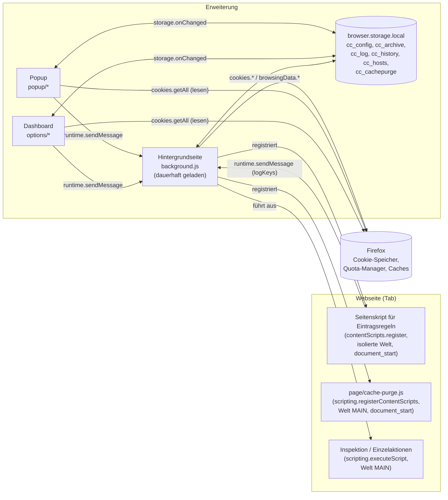
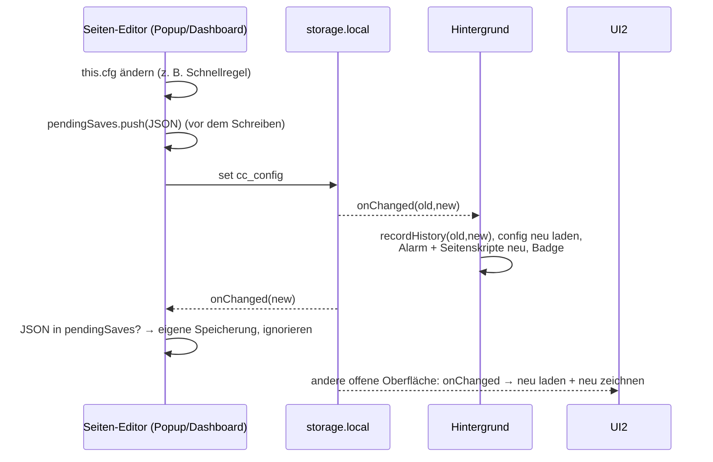

# 01 – Architektur

## 1.1 Überblick

Cookie Curator ist eine **Manifest-V2-Erweiterung** für Firefox (≥ 140). Sie besteht aus fünf
Ausführungskontexten, die über Nachrichten und den Erweiterungsspeicher zusammenarbeiten:



**Grundprinzip:** Die Oberflächen (Popup, Dashboard) **lesen** Cookies und Konfiguration direkt und
**schreiben** die Konfiguration direkt in `storage.local`. Alles, was **Daten im Browser verändert**
(Cookies löschen/setzen, Website-Daten löschen, Archiv schreiben, Protokoll führen), läuft über die
Hintergrundseite. Begründung siehe [09, E-03](09-designentscheidungen.md#e-03-schreibende-aktionen-nur-im-hintergrund).

## 1.2 Dateien

```
manifest.json            Berechtigungen, Hintergrundskripte, Popup, Dashboard
background.js            Hintergrundseite: Auslöser, Löschen, Blockieren, Archiv, Protokoll,
                         Verlauf, Website-Daten, Nachrichten-Schnittstelle
lib/core.js              Gemeinsame Logik (global CC): Datenmodell, Domains, Regel-Engine,
                         Klassifizierung, Cookie-Hilfen, Archiv-Hilfen, Website-Daten-Logik
lib/pagefns.js           Funktionen, die im Kontext der Webseite laufen (global PAGE_FNS)
ui/ui.js                 Gemeinsame UI (global UI): DOM-Helfer, Regeltabellen, Archivtabelle,
                         Rückgängig-Knöpfe, „Alles löschen“, Seiten-Editor (Klasse SiteEditor)
ui/tables.js             Veränderbare und automatisch eingepasste Spaltenbreiten (global CCTables)
ui/ui.css                Gemeinsames Aussehen, Farben (hell/dunkel)
popup/popup.html|js      Toolbar-Popup: Seiten-Editor der aktuellen Seite (kompakt)
options/options.html|js  Dashboard: Routing, Seitenübersicht, globale Regeln, Kategorien,
                         Einstellungen, Archiv, Protokoll, Import/Export
options/help.js          Inhalt des Tabs „Funktionsweise“
options/options.css      Dashboard-spezifisches Aussehen
page/cache-purge.js      Löscht Cache Storage beim nächsten Seitenaufruf (Welt MAIN, document_start)
icons/icon.svg           Symbol
docs/                    Diese Dokumentation (wird nicht ins XPI gepackt)
tests/                   Einheiten-, Oberflächen- und Firefox-Tests mit Testumgebung (siehe 10.3)
tools/                   build_xpi.py (Paket erzeugen), build_pdf.py (PDF dieser Doku erzeugen)
```

Grösse: rund 4300 Zeilen JavaScript/CSS/HTML, **ohne externe Bibliotheken**.

## 1.3 Ladereihenfolge

Alle Dateien sind klassische Skripte (keine ES-Module), die sich über globale Objekte verbinden:

| Kontext | Reihenfolge | Globale Objekte |
|---|---|---|
| Hintergrund | `lib/core.js` → `lib/pagefns.js` → `background.js` | `CC`, `PAGE_FNS` |
| Popup | `lib/core.js` → `ui/ui.js` → `ui/tables.js` → `popup/popup.js` | `CC`, `UI`, `CCTables` |
| Dashboard | `lib/core.js` → `ui/ui.js` → `ui/tables.js` → `options/help.js` → `options/options.js` | `CC`, `UI`, `CCTables`, `buildHelp` |

Warum keine Module: siehe [09, E-05](09-designentscheidungen.md#e-05-klassische-skripte-und-globale-namensräume).

## 1.4 Die Kontexte im Detail

### Hintergrundseite (`background.js`)

* **Dauerhaft geladen** (MV2-Hintergrundseite ohne `"persistent": false`). Sie hält Zustand im
  Speicher: Tab→Seite-Zuordnung (`tabSites`), geplante Tab-Schliessen-Bereinigungen
  (`pendingTabClose`), Host-Register (`siteHosts`), Protokoll-Puffer, Verlauf.
* Startet mit der IIFE `ready = init()`: Konfiguration, Protokoll, offene Tabs, Host-Register laden,
  Intervall-Alarm planen, Seitenskripte registrieren, Badge aktualisieren. **Jeder Ereignis-Handler
  wartet auf `ready`**, damit nie mit Standardkonfiguration gearbeitet wird.
* Hört auf: `tabs.onUpdated/onRemoved/onActivated`, `cookies.onChanged`, `storage.onChanged`,
  `alarms.onAlarm`, `runtime.onStartup/onInstalled/onMessage`.

### Popup (`popup/`)

* Lebt nur, solange es offen ist. Firefox begrenzt es auf 800 × 600 px.
* Ermittelt die Seite des aktiven Tabs und zeigt einen **kompakten** `SiteEditor`.
* Lange Vorgänge werden nicht im Popup ausgeführt, sondern per Nachricht an den Hintergrund
  übergeben – schliesst sich das Popup, läuft die Aktion trotzdem zu Ende.

### Dashboard (`options/`)

* Eine Seite mit **Hash-Routing** (`#sites`, `#site/<seite>`, `#rules`, `#categories`,
  `#settings`, `#archive`, `#log`, `#backup`, `#help`). `render()` liest `location.hash` und baut
  die Ansicht neu.
* `#site/<seite>` verwendet denselben `SiteEditor` wie das Popup, aber nicht kompakt.

### Seitenskript für Eintragsregeln (isolierte Welt)

* Wird von `registerPageScripts()` pro Seite mit selektivem Modus per `contentScripts.register`
  angemeldet (`runAt: document_start`, nur Hauptframe). Der Code ist ein **Text**, der die Regeln
  als JSON enthält (`CC.pageKeyCleanerCode(R)`) – so laufen die Regeln synchron, bevor die Skripte
  der Seite starten. Details: [05](05-website-daten.md#53-selektiv-eintragsregeln).

### Seitenkontext-Skripte (Welt „MAIN“)

* Für die Live-Ansicht und Einzelaktionen (Datenbank löschen, Cache-Eintrag löschen, Service Worker
  abmelden) führt der Hintergrund Funktionen aus `PAGE_FNS` per
  `scripting.executeScript({ world: "MAIN" })` aus – also **wie ein eigenes Skript der Webseite**.
  Warum nicht im Content-Script: [06.8](06-firefox-interna.md#68-skript-welten-isolierte-welt-xray-und-main).

## 1.5 Nachrichten-Schnittstelle (Hintergrund)

Alle Nachrichten sind Objekte `{ cmd, … }`. Der Handler ist `async` und gibt das Ergebnis als
Promise zurück (Firefox unterstützt das direkt bei `runtime.onMessage`).

| `cmd` | Parameter | Ergebnis | Zweck |
|---|---|---|---|
| `cleanSite` | `site, dryRun` | Liste gelöschter Einträge | Seite nach Richtlinie bereinigen (Cookies + Website-Daten) |
| `cleanAll` | `skipOpen, dryRun` | Liste | Alle Seiten bereinigen bzw. Vorschau |
| `deleteCookies` | `cookies, reason` | Anzahl | Cookies löschen (geprüft, mit Ausweichweg) |
| `deleteCookiesDetailed` | `cookies, reason` | `{removedIds, failed}` | wie oben, mit Einzelergebnis für die Oberfläche |
| `purgeSite` | `site, removeConfig` | Zusammenfassung | „Alles löschen“ einer Seite |
| `openSites` | – | Liste Seiten | Seiten mit offenem Tab |
| `pendingTabClose` | – | Liste | geplante Tab-Schliessen-Bereinigungen |
| `getLog` / `clearLog` | – | Protokoll | Protokoll lesen/leeren |
| `archive` | `cookies, note` | `{added, skipped}` | Cookies archivieren |
| `archiveAndDelete` | `cookies, note` | `{added, skipped, deleted}` | archivieren und löschen |
| `archiveUpdate` | `aid, patch` | bool | Autostart, Notiz oder Wert eines Archiv-Eintrags ändern |
| `archiveRemove` | `aids` | Anzahl | Archiv-Einträge entfernen |
| `archiveImport` | `entries` | Anzahl | Archiv-Einträge importieren |
| `restore` | `aids` | `{ok, failed}` | Archiv-Versionen zurückholen |
| `restoreAutostart` | – | `{ok, failed}` | Autostart-Einträge jetzt anwenden |
| `historyState` / `undo` / `redo` / `historyClear` | – | Verlaufsstatus | Rückgängig/Wiederholen |
| `inspectStorage` | `site` | `{open, tabId, data}` | Website-Daten eines offenen Tabs lesen |
| `storageItem` | `site, op, args` | `{ok, …}` | Einzelaktion im Seitenkontext |
| `siteHosts` | `site` | Liste Hosts | alle bekannten Hosts einer Seite |
| `cleanStorage` | `site, dryRun` | Liste | Website-Daten nach Richtlinie löschen |
| `deleteStorageNow` | `site, type` | Liste Hosts | eine Speicherart sofort komplett löschen (Cache Storage: offene Tabs sofort, sonst vormerken) |
| `cachePurgePending` | `site` (optional) | Liste Hosts | Hosts, deren Cache Storage beim nächsten Aufruf gelöscht wird |
| `applyKeyRules` | `site` | Ergebnisse pro Tab | Eintragsregeln in offenen Tabs anwenden |
| `removeKeys` | `site, store, keys` | Ergebnisse | einzelne Einträge löschen |
| `logKeys` | `host, removed, trigger` | – | vom Seitenskript: gelöschte Einträge protokollieren |

## 1.6 Datenfluss bei einer Konfigurationsänderung



Warum das „vor dem Schreiben vormerken“ wichtig ist, erklärt [07.4](07-oberflaeche.md#74-eigene-speicherungen-erkennen).
