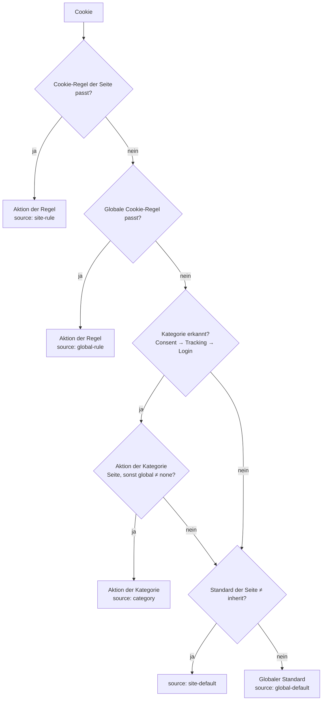

# 03 – Entscheidungslogik

## 3.1 Seiten-Zuordnung

Jedes Cookie wird **einer Seite** zugeordnet (`CC.siteKeyForCookie`):

1. Ist das Cookie **partitioniert** (`cookie.partitionKey.topLevelSite` gesetzt), gehört es zur
   **Top-Level-Seite der Partition**: Ein Werbe-Cookie von `doubleclick.net`, das auf `nzz.ch`
   eingebettet entstand, erscheint unter `nzz.ch` (markiert mit `3P`).
2. Sonst: Basisdomain des Cookies (`baseDomain(cookie.domain)`).

`baseDomain(host)` bestimmt die registrierbare Domain (eTLD+1) mit einer **kompakten Liste
mehrteiliger Public Suffixes** (`co.uk`, `com.au`, `github.io`, `pages.dev`, …) plus vom Benutzer
ergänzten Suffixes. IP-Adressen und einteilige Hosts (`localhost`) bleiben unverändert.

> Warum keine vollständige Public Suffix List? Firefox stellt seinen eingebauten eTLD-Dienst
> (`Services.eTLD`) Erweiterungen nicht zur Verfügung, und die vollständige Liste (~250 KB) mitzuliefern
> und aktuell zu halten, wäre unverhältnismässig. Siehe [09, E-08](09-designentscheidungen.md).

Folge für Sonderfälle: Ein Partitionsschlüssel wie `https://2331317e-….mozilla` (Inhalte, die in
einer anderen Erweiterung eingebettet sind) ergibt die „Seite“ `2331317e-….mozilla`. Siehe
[06.5](06-firefox-interna.md#65-partitionsschlüssel-neues-und-altes-format).

## 3.2 Cookie: Behalten, Löschen oder Blockieren

`CC.evaluate(cookie, cfg, siteOverride?)` liefert
`{ action, source, reason, ruleId, category, pattern, site }`. **Die erste Stufe, die zutrifft,
entscheidet:**

* **Regel passt** (`ruleMatches`): aktiv, Name passt (exact/glob/regex), Domain-Glob passt auf
  `cookie.domain` ohne Punkt (falls gesetzt), Pfad-Glob passt (falls gesetzt), Container gleich
  (falls gesetzt).
* **Glob:** `*` beliebig viele Zeichen, `?` genau eines, ohne Beachtung der Gross-/Kleinschreibung.
  Glob und Regex werden in einem Zwischenspeicher (`reCache`) übersetzt, weil `evaluate` für jedes
  Cookie bei jedem Neuzeichnen läuft.
* **Regex:** `/muster/flags`; ohne Schrägstriche als case-insensitives Muster interpretiert.
  Ungültige Ausdrücke passen nie (und werden in der Oberfläche rot markiert).
* **Kategorie** (`classify`): Prüfreihenfolge Consent → Tracking → Login/Session; das erste passende
  Namensmuster zählt. Die Reihenfolge ist gewollt: `_hjSessionUser_…` (Hotjar) enthält „Session“,
  ist aber Tracking und muss vor Login geprüft werden.
* `reason` ist ein lesbarer Text („Kategorie Tracking (global, Muster _ga)“), der in der Spalte
  *Begründung* und im Protokoll erscheint. **Jede Entscheidung ist so nachvollziehbar.**

### Bedeutung der Aktionen

| Aktion | Wirkung |
|---|---|
| `keep` | Bleibt bei allen Bereinigungen. |
| `delete` | Wird bei der nächsten Bereinigung gelöscht (Tab zu, Start, Intervall, manuell). |
| `block` | Wie `delete`, zusätzlich **sofort** gelöscht, sobald es gesetzt wird (`cookies.onChanged`). |

„Blockieren“ ist **kein Filter vor dem Setzen** – Erweiterungen können das Setzen eines Cookies nicht
verhindern, nur danach reagieren (oder per `webRequest` Header verändern, siehe
[09, E-07](09-designentscheidungen.md)). Die Seite kann das Cookie für einen Augenblick lesen.

## 3.3 Website-Daten: Modus pro Speicherart

`CC.effectiveStorageMode(cfg, site, type)`: Wert der Seite, wenn nicht `inherit`, sonst globaler
Wert, sonst `keep`.

| Speicherart | Mögliche Modi | Wirkung von „delete“ |
|---|---|---|
| localStorage | keep, delete, selective | ganzer Speicher pro Host bei Bereinigung |
| sessionStorage | keep, selective | – (verschwindet mit dem Tab) |
| IndexedDB | keep, delete | alle Datenbanken pro Host |
| Cache Storage | keep, delete | alle Caches pro Host – sofort in offenen Tabs, sonst beim nächsten Aufruf (siehe [05.6](05-website-daten.md#56-löschen-bei-bereinigung)) |
| Service Worker | keep, delete | Registrierungen pro Host abmelden |
| HTTP-Cache | keep, delete | Cache pro Host (mit Firefox-Einschränkung, siehe 06) |

`CC.storageDeleteTypes(cfg, site)` liefert die Arten im Modus „delete“. Alle ausser Cache Storage
(`CC.BROWSING_DATA_TYPES`) gehen bei einer Bereinigung an `browsingData.remove`; Cache Storage läuft
über einen eigenen Weg.

## 3.4 Eintrag in local-/sessionStorage

Nur im Modus **selective**: `CC.evalKey(cfg, site, store, key)`

1. erste aktive Eintragsregel mit passendem Speicher (`both` oder gleicher) und passendem Namen,
2. sonst `keyDefault` der Seite („Standard für übrige Einträge“).

Im Modus `keep` lautet das Ergebnis immer „Behalten“, im Modus `delete` „Löschen (ganzer Speicher)“.
Eintragsregeln gibt es **nur pro Seite**, nicht global – globale Eintragsregeln würden auf allen
Seiten Code einschleusen müssen (siehe [09, E-10](09-designentscheidungen.md)).

## 3.5 Bereinigen beim Tab-Schliessen

`CC.effectiveTabClose(cfg, site)`: `tabClose` der Seite (`on`/`off`), sonst
`settings.cleanOnTabClose`. Gilt gemeinsam für Cookies **und** Website-Daten – darum steht die
Einstellung im Bereich „Allgemein“ und nicht bei den Cookies.
