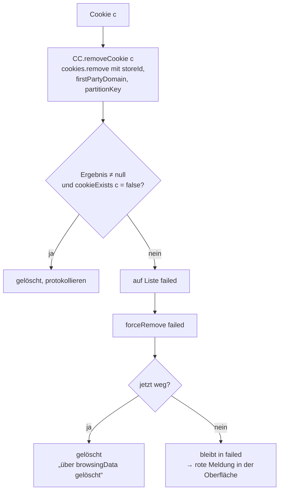
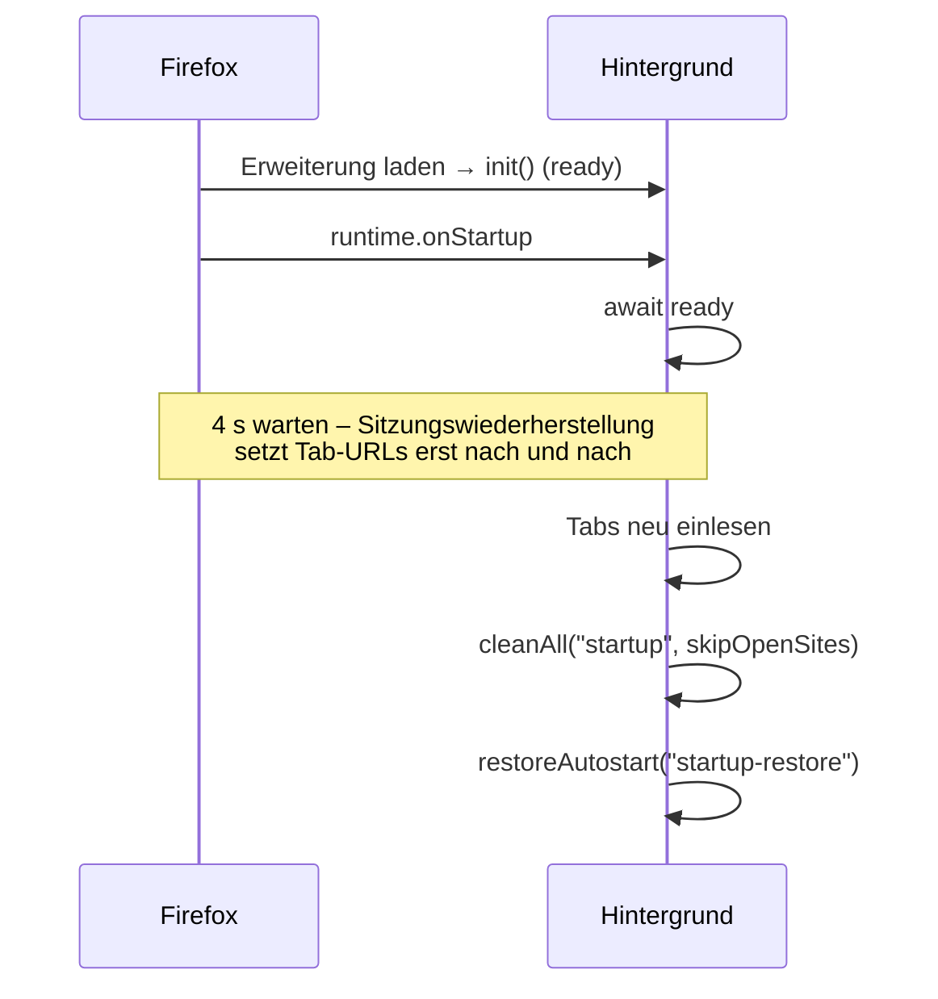

# 04 – Bereinigung und Löschen

Dieses Kapitel beschreibt, **wann** gelöscht wird und **wie** ein Löschvorgang technisch abläuft –
inklusive des Prüf- und Ausweichwegs, der nötig ist, weil `cookies.remove()` in Firefox nicht jedes
Cookie trifft.

## 4.1 Auslöser im Überblick

| Auslöser (`trigger`) | Wo im Code | Was passiert | Offene Seiten |
|---|---|---|---|
| `tab-close` | `siteLeft` → Timer → `cleanSite` | Letzter Tab einer Seite geschlossen/weg-navigiert, nach Verzögerung | nie (nur wenn wirklich zu) |
| `startup` | `runtime.onStartup` → 4 s → `cleanAll` | Bereinigung aller Seiten beim Browserstart | ausgelassen, wenn `skipOpenSites` |
| `interval` | `alarms.onAlarm("cc-periodic")` → `cleanAll` | Regelmässig, alle `periodicMinutes` | ausgelassen, wenn `skipOpenSites` |
| `manual` | Nachrichten `cleanSite`, `cleanAll`, `deleteCookies…`, `purgeSite`, … | Knöpfe in Popup/Dashboard | wie gewählt |
| `block` | `cookies.onChanged` | Cookie mit Aktion „block“ wurde gesetzt → sofort löschen | immer |
| `page-load` | Seitenskript (Eintragsregeln) | Einträge in local-/sessionStorage beim Laden | immer |

## 4.2 Tab-Verfolgung

Der Hintergrund führt eine Tabelle **Tab → Seite** (`tabSites: Map<tabId, site>`):

* `init()` liest alle offenen Tabs beim Laden der Erweiterung.
* `tabs.onUpdated` (nur bei `url`- oder `status`-Änderung): neue Seite eintragen; hatte der Tab vorher
  eine **andere** Seite, wird für diese `siteLeft(alt)` aufgerufen. Navigieren von `nzz.ch` nach
  `srf.ch` im selben Tab gilt also als „nzz.ch verlassen“.
* `tabs.onRemoved`: Eintrag entfernen und `siteLeft(seite)`.
* `setTabSite` merkt sich zusätzlich den **Host** im Host-Register (siehe [05](05-website-daten.md)).

`siteLeft(site)`:

1. Ist noch ein anderer Tab mit derselben Seite offen → nichts tun.
2. Ist „Bereinigen beim Tab-Schliessen“ für die Seite aus (`effectiveTabClose`) → nichts tun.
3. Sonst einen Timer über `tabCloseDelaySec` Sekunden setzen (`pendingTabClose: Map<site, timeoutId>`).
4. Wird die Seite vor Ablauf wieder geöffnet, löscht `setTabSite` den Timer.
5. Läuft der Timer ab und ist die Seite immer noch zu → `cleanSite(site, "tab-close")`.

**Warum eine Verzögerung?** Ohne sie würde ein Neuladen, ein Login-Weiterleitungs-Hüpfer über eine
andere Domain oder das versehentliche Schliessen und sofortige Wiederherstellen (Strg+Umschalt+T)
bereits eine Bereinigung auslösen. 15 s haben sich als Kompromiss bewährt; 0 ist möglich.

**Grenze:** Die Timer leben nur im Speicher. Wird Firefox innerhalb der Verzögerung beendet, geht
der Timer verloren – deshalb gibt es die Bereinigung beim Start, die das nachholt.

Private Fenster und Container zählen dabei gleich: Die Seite ist offen, wenn sie in *irgendeinem*
Tab offen ist. (Eine Trennung nach Container wäre möglich, siehe [10](10-grenzen-tests-erweiterung.md).)

## 4.3 Planen: `plan(cookies)`

Für jede Kandidatenliste wird `CC.evaluate` aufgerufen; alles mit `delete` oder `block` kommt auf
die Löschliste, die Begründung wird in einer `Map<cookieId, reason>` gemerkt, damit das Protokoll
später schreiben kann, *warum* gelöscht wurde.

* `cleanSite(site)` – Kandidaten: `CC.getCookiesForSite(site)` (alle Cookies, deren Seiten-Schlüssel
  passt, inkl. partitionierter Cookies von Drittanbietern auf dieser Seite). Danach
  `cleanStorage(site)` für Website-Daten.
* `cleanAll()` – Kandidaten: alle Cookies, optional ohne offene Seiten. Website-Daten für die
  Vereinigung aus *Seiten im Host-Register*, *konfigurierten Seiten* und *Seiten mit Cookies*.
* `dryRun: true` liefert nur die Liste (Vorschau im Dashboard „Was würde gelöscht?“).

## 4.4 Löschen mit Prüfung: `deleteList`



**Warum prüfen?** `cookies.remove()` meldet in Firefox auch dann Erfolg (gibt ein Objekt zurück),
wenn es das Cookie gar nicht getroffen hat. Konkret passiert das bei Cookies, deren
**Partitionsschlüssel im alten Format** gespeichert ist – siehe
[06.5](06-firefox-interna.md#65-partitionsschlüssel-neues-und-altes-format). Ohne Prüfung zeigte die
Oberfläche „gelöscht“, das Cookie war aber noch da (das war der Fehler mit den widersprüchlichen
roten/orangen Meldungen).

`cookieExists(c)` liest `cookies.getAll({ name, storeId, firstPartyDomain: null, partitionKey: {} })`
und vergleicht die **Cookie-ID**. `firstPartyDomain: null` und `partitionKey: {}` bedeuten „alle
FPI-Domains“ bzw. „alle Partitionen“ – ohne diese Angaben liefert Firefox nur unpartitionierte
Cookies und wirft bei aktivierter First-Party-Isolation sogar einen Fehler.

## 4.5 Ausweichweg: `forceRemove`

`browsingData.removeCookies({ hostnames: [host], cookieStoreId })` arbeitet intern anders als
`cookies.remove`: Es iteriert über **alle** Cookies des Profils und entfernt jedes, dessen Host
exakt passt, **mit dessen eigenen OriginAttributes** – damit trifft es jedes Partitionsformat.
Nachteil: Es löscht *alle* Cookies dieses Hosts im Container, nicht nur das gewünschte.

Ablauf:

1. Fehlgeschlagene Cookies nach `host|storeId` gruppieren.
2. Alle Cookies dieses Hosts/Containers lesen, die **nicht** gelöscht werden sollen (`keep`).
3. Deren IDs in das Set `restoring` eintragen (damit die Blockier-Logik sie nicht sofort wieder
   löscht, falls eine Block-Regel passt).
4. `browsingData.removeCookies` aufrufen.
5. Alle `keep`-Cookies mit `cookies.set(CC.restoreDetails(x, 0))` neu setzen.
6. Nach 2 s die IDs aus `restoring` entfernen.
7. Erneut prüfen, welche Ziel-Cookies jetzt weg sind.

**Nebenwirkung, bewusst in Kauf genommen:** Ein Cookie, das behalten werden soll und selbst einen
Partitionsschlüssel im alten Format hatte, wird mit dem **neuen** Format neu gesetzt (Firefox
erlaubt das Setzen im alten Format über die API nicht). Für die Webseite ist das gleichwertig –
das neue Format ist das, was Firefox ab jetzt selbst verwenden würde.

## 4.6 Blockieren

```js
browser.cookies.onChanged.addListener(async (info) => {
  if (!info.removed && config.settings.enforceBlock && !restoring.has(CC.cookieId(info.cookie))) {
    const ev = CC.evaluate(info.cookie, config);
    if (ev.action === "block") { await CC.removeCookie(info.cookie); addLog("block", …); }
  }
  …
});
```

* Reagiert nur auf **gesetzte** Cookies (`removed: false`).
* `restoring` verhindert, dass ein absichtlich wiederhergestelltes Cookie (Archiv, Ausweichweg) sofort
  wieder entfernt wird.
* `onChanged` feuert in Firefox **nach** dem Setzen; die Seite (und der Server bei der nächsten
  Anfrage, falls das Löschen zu spät kommt) kann den Wert theoretisch sehen. Siehe
  [09, E-07](09-designentscheidungen.md#e-07-blockieren-über-cookiesonchanged-statt-webrequest).

## 4.7 „Alles löschen“ einer Seite: `purgeSite`

Vom Benutzer gewünscht: ein Knopf pro Seite, nach dem die Seite **aus der Übersicht verschwindet**.
Damit sie verschwindet, muss alles weg sein, was die Übersicht als „Seite“ zählt:

1. **Alle Cookies der Seite** über `deleteList` (also mit Prüfung und Ausweichweg).
2. **Website-Daten**: `browsingData.remove({hostnames}, {localStorage|indexedDB|serviceWorkers|cache})`
   – jede Art einzeln, damit ein Fehler bei einer Art die anderen nicht verhindert. Dazu **Cache
   Storage** über `purgeCacheStorage` (offene Tabs sofort, übrige Hosts beim nächsten Aufruf,
   siehe [05.6](05-website-daten.md#56-löschen-bei-bereinigung)). Bis 0.6.1 fehlte dieser Schritt:
   Cache Storage blieb nach „Alles löschen“ stehen.
3. **sessionStorage** in offenen Tabs der Seite per Skript (`sessionStorage.clear()`), da
   `browsingData` sessionStorage nicht kennt.
4. **Host-Register** der Seite leeren (`siteHosts.delete`), sonst würde die Seite weiterhin als
   „bekannt“ erscheinen.
5. Optional (Standard): **Seitenkonfiguration entfernen** – das Dashboard fragt das per Häkchen.
   Dieser Schritt geht in den Verlauf und ist rückgängig zu machen; die gelöschten Daten nicht.

Ist danach noch ein Tab der Seite offen, legt die Seite beim nächsten Seitenaufruf sofort wieder
Cookies an – die Oberfläche weist darauf hin (`openTabs` im Ergebnis).

## 4.8 Start-Ablauf



**Reihenfolge ist wichtig:** Zuerst bereinigen, dann Archiv-Versionen setzen. Andersherum würde die
Bereinigung ein eben zurückgesetztes Cookie wieder löschen, wenn es nach Richtlinie „löschen“ ist.

`runtime.onStartup` feuert nur beim **Browserstart** mit diesem Profil, nicht beim Installieren oder
Aktualisieren der Erweiterung und nicht beim Neuladen in `about:debugging`.

## 4.9 Badge

`updateBadge(tab)` zeigt pro Tab entweder die Zahl der Cookies, die beim nächsten Bereinigen gelöscht
würden (`pending`, orange bzw. grün bei 0), oder die Gesamtzahl (`total`). Neu berechnet wird
gebündelt (600 ms nach dem letzten `cookies.onChanged`), beim Tab-Wechsel und nach jedem Löschen.
Seiten mit sehr vielen Cookie-Änderungen (Werbung) würden sonst Hunderte Neuberechnungen pro Sekunde
auslösen.
