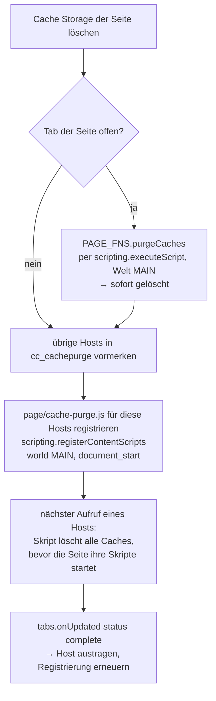

# 05 – Website-Daten

„Website-Daten“ sind alle Speicher, die eine Webseite im Browser anlegen kann, **ausser Cookies**.
Firefox behandelt sie technisch völlig anders als Cookies – darum ist auch die Umsetzung im Add-on
eine andere.

## 5.1 Speicherarten und was Firefox Erweiterungen erlaubt

| Speicherart | Gebunden an | Firefox-Verwaltung | Lesen durch Erweiterung | Löschen durch Erweiterung |
|---|---|---|---|---|
| localStorage | Origin | LSNG (Datastore pro Origin, SQLite im Profil `storage/default/<origin>/ls`) | nur aus der Seite heraus (Skript) | `browsingData.remove({hostnames},{localStorage})` oder Skript |
| sessionStorage | Origin **und Tab** | im Speicher des Inhaltsprozesses, gespiegelt für Sitzungswiederherstellung | nur aus der Seite heraus | nur aus der Seite heraus |
| IndexedDB | Origin | Quota-Manager, SQLite pro Datenbank | nur aus der Seite heraus | `browsingData.remove({hostnames},{indexedDB})` oder Skript |
| Cache Storage | Origin | Quota-Manager (Client „cache“) | nur aus der Seite heraus | nur Skript (kein browsingData-Typ, siehe 5.6) |
| Service Worker | Origin + Scope | ServiceWorkerManager | nur aus der Seite heraus | `browsingData.remove({hostnames},{serviceWorkers})` oder Skript |
| HTTP-Cache | URL (+ Partition) | Netzwerk-Cache (cache2) | gar nicht | `browsingData.remove({hostnames},{cache})` mit Einschränkung |

Die wichtigsten zwei Einschränkungen:

1. **Es gibt keine API zum Lesen.** `browsingData` kann nur löschen. Alles, was die Oberfläche
   „live“ anzeigt, liest ein Skript, das im offenen Tab der Seite ausgeführt wird. Ist kein Tab
   offen, gibt es keine Live-Ansicht.
2. **`hostnames` muss exakt passen.** `browsingData.remove({hostnames: ["nzz.ch"]})` löscht nicht
   die Daten von `www.nzz.ch`. Firefox vergleicht den Host des Origins genau (keine Subdomains).

## 5.2 Das Host-Register

Wegen Punkt 2 merkt sich der Hintergrund pro Seite, **welche Hosts tatsächlich besucht wurden**
(`siteHosts`, gespeichert als `cc_hosts`):

* Jede Tab-URL (`setTabSite` → `rememberHost(site, url.host)`). Der Host enthält den Port
  (`localhost:8765`), weil Origins mit Port getrennt sind.
* Begrenzung 300 Hosts pro Seite (älteste fallen raus), gespeichert gebündelt nach 500 ms.

`hostsForSite(site, cookies)` = `{site, "www."+site}` ∪ Host-Register ∪ Hosts aller
**nicht partitionierten** Cookies der Seite. Partitionierte Cookies werden ausgelassen: Ihre Domain
ist die eines Drittanbieters (z. B. `doubleclick.net`), dessen eigene Website-Daten nicht zur Seite
gehören.

**Lücke:** Hosts, die nur in **Iframes** vorkommen, landen nicht im Register (Tabs liefern nur die
URL des Hauptdokuments). Deren Daten liegen ohnehin partitioniert unter der Top-Level-Seite (siehe
06.4) und werden von Firefox beim Löschen der Top-Level-Hosts *nicht* automatisch mitgelöscht.
Siehe [10](10-grenzen-tests-erweiterung.md).

## 5.3 Selektiv (Eintragsregeln)

Für local- und sessionStorage gibt es neben „Behalten“/„Löschen“ den Modus **Selektiv**: einzelne
Einträge nach Namensmuster löschen, den Rest behalten. Da es keine API gibt, um einzelne Einträge von
aussen zu löschen, läuft hier Code **in der Seite**.

### Registrierung

`registerPageScripts()` (Hintergrund) läuft beim Start und 300 ms nach jeder Konfigurationsänderung:

1. Alle bisherigen Registrierungen abmelden.
2. Für jede Seite mit selektivem Modus `CC.pageKeyRules(config, site)` berechnen:
   `{ local: {def, rules} | null, session: {def, rules} | null }`.
3. `browser.contentScripts.register({ matches: ["*://site/*", "*://*.site/*"], js: [{ code }],
   runAt: "document_start", allFrames: false })`.

Der `code` ist `"(" + pageKeyCleaner.toString() + ")(" + JSON.stringify(R) + ");"` – die
Funktion **mit den Regeln als eingebettetem JSON**.

### Warum so?

* **`document_start`** – das Skript läuft, bevor irgendein Skript der Seite Zugriff auf den Speicher
  hat. Ein Tracking-Skript findet seinen alten Eintrag nicht mehr vor.
* **Regeln eingebettet statt per Nachricht geholt** – eine Nachricht an den Hintergrund ist
  asynchron; bis die Antwort käme, wären die Seitenskripte schon gelaufen. Mit eingebetteten
  Regeln läuft alles **synchron**.
* **`contentScripts.register` statt `manifest.content_scripts`** – nur Seiten mit selektivem Modus
  bekommen Code eingeschleust, alle anderen Seiten bleiben unberührt (Leistung, Datenschutz,
  geringere Angriffsfläche).
* **Nur Hauptframe** – Iframes hätten oft eine andere Origin; die Regel ist aber für die Seite
  gedacht. Zudem würde `allFrames` den Code in jede Werbe-Iframe schleusen.

`pageKeyCleaner` geht alle Schlüssel durch, nimmt die erste passende Regel (sonst `def`) und löscht
bei `delete`. Gelöschte Schlüssel meldet es per `runtime.sendMessage({cmd:"logKeys"})` für das
Protokoll – **erst danach**, asynchron, das blockiert die Seite nicht.

### Zusätzlich manuell

* „Regeln jetzt anwenden“ → Nachricht `applyKeyRules` → derselbe Code per `tabs.executeScript` in
  allen offenen Tabs der Seite.
* „Löschen“ bei einzelnen Einträgen → `removeKeys`.

## 5.4 Warum Regeln für sessionStorage?

Häufige Frage (auch vom Benutzer gestellt): sessionStorage verschwindet doch ohnehin? Nicht ganz:

* sessionStorage lebt **so lange wie der Tab**, nicht wie die Browsersitzung. Ein Tab, der tagelang
  offen ist, behält ihn tagelang.
* **Sitzungswiederherstellung** (Firefox-Einstellung „Vorherige Sitzung wiederherstellen“ oder nach
  einem Absturz) stellt sessionStorage **wieder her** – gemessen in Firefox 140.
* **Tab duplizieren** kopiert den sessionStorage in den neuen Tab.
* Tracking-Skripte legen dort Sitzungs-IDs ab, die über Seitenaufrufe hinweg bestehen.

Darum gibt es für sessionStorage die Modi „Behalten“ und „Selektiv“. „Löschen“ (komplett bei
Bereinigung) gibt es nicht, weil `browsingData` sessionStorage nicht kennt und eine Bereinigung
ohnehin nur bei **geschlossenen** Tabs läuft – da ist er weg (ausser bei Wiederherstellung, wo
„Selektiv“ beim Laden greift).

## 5.5 Live-Ansicht und Einzelaktionen

Die Oberfläche fragt `inspectStorage(site)` an. Der Hintergrund wählt einen Tab der Seite (bevorzugt
den aktiven, `preferredTab`) und führt `PAGE_FNS.inspect` per
`scripting.executeScript({ target: {tabId, frameIds:[0]}, world: "MAIN", func, args })` aus.

`inspect` liefert:

* local-/sessionStorage: alle Einträge mit Wert (gekürzt auf 4000 Zeichen) und Grösse,
* IndexedDB: Datenbanken → Object Stores → Anzahl Einträge (`indexedDB.databases()`, dann jede DB
  öffnen; `onupgradeneeded` bricht ab, damit keine leere DB angelegt wird),
* Cache Storage: Cache-Namen mit bis zu 200 URLs,
* Service Worker: Scope, Skript-URL, Zustand,
* `navigator.storage.estimate()` und `persisted()`.

Einzelaktionen (`storageItem`, Liste `ITEM_OPS`): `deleteIdb`, `clearIdbStore`, `deleteCache`,
`deleteCacheEntry`, `unregisterSw`. Jede Funktion ist **in sich geschlossen** (keine Verweise nach
aussen), weil `executeScript` sie als Quelltext serialisiert; Rückgabewerte müssen strukturiert
klonbar sein.

**`deleteIdb` und „blockiert“:** Hält die Seite eine Verbindung zur Datenbank offen, feuert
`onblocked`, und die Löschung wartet, bis die Verbindung geschlossen wird (spätestens beim Schliessen
des Tabs). Nach 3 s meldet die Funktion `pending: true` – die Oberfläche zeigt das an und
protokolliert „läuft nach Schliessen der Verbindung“.

Warum Welt **MAIN** und nicht das übliche Content-Script: siehe
[06.8](06-firefox-interna.md#68-skript-welten-isolierte-welt-xray-und-main).

## 5.6 Löschen bei Bereinigung

`cleanStorage(site)` sammelt alle Arten im Modus „delete“. Die Arten, die Firefox über
`browsingData` kennt (`CC.BROWSING_DATA_TYPES`: localStorage, IndexedDB, Service Worker, HTTP-Cache),
gehen in **einem** Aufruf `browsingData.remove({hostnames}, {localStorage:true, indexedDB:true, …})`.
Schlägt das fehl (ein Typ wird nicht unterstützt), folgt ein zweiter Versuch **pro Typ einzeln**.
Jede gelöschte Art wird als `kind: "storage"` protokolliert.

**HTTP-Cache:** siehe [06.6](06-firefox-interna.md#66-browsingdata-intern) – je nach Firefox-Version
kann ein hostbezogener Aufruf auf „ganzen Cache leeren“ zurückfallen. Darum steht der Modus
standardmässig auf „Behalten“ und die Hilfe warnt davor.

## 5.7 Cache Storage (ab 0.7)

### Das Problem

Cache Storage (die Cache API, `caches.open(…)`) hat in `browsingData` **keinen eigenen Typ**. Man
könnte annehmen, dass der Typ `indexedDB` ihn mitnimmt, weil beide im Quota-Manager liegen. Das stimmt
nicht: Firefox löscht dort gezielt nur den Client `"idb"`
(`Services.qms.clearStoragesForClient(principal, "idb")`), nicht den Client `"cache"` – siehe
[06.6](06-firefox-interna.md#66-browsingdata-intern). In echtem Firefox 140 nachgeprüft: Nach
`browsingData.remove({hostnames:["localhost"]}, {indexedDB:true})` war ein vorher angelegter Cache
unverändert vorhanden.

Bis Version 0.6.1 hatte das Add-on deshalb **keinen** Modus für Cache Storage, und „Alles löschen“
sowie die Bereinigung liessen ihn stehen. Die Seite verschwand zwar aus der Übersicht, ihre Caches
lagen aber weiter im Profil.

### Die Lösung: sofort oder beim nächsten Aufruf

Löschen kann Cache Storage nur Code, der **in der Origin der Seite** läuft. `purgeCacheStorage(site,
hostnames)` im Hintergrund arbeitet darum in zwei Schritten:

1. **Offene Tabs:** In jedem offenen Tab der Seite läuft `PAGE_FNS.purgeCaches` (alle
   `caches.keys()` → `caches.delete`). Der Host dieses Tabs ist damit erledigt.
2. **Alle anderen Hosts** (aus `hostsForSite`, ohne Port) kommen in die Vormerkliste
   `cachePurgeHosts` (gespeichert als `cc_cachepurge`). `registerCachePurge()` meldet **ein**
   Skript `cc-cache-purge` mit allen vorgemerkten Hosts als `matches` an.
3. Ruft der Benutzer einen vorgemerkten Host wieder auf, läuft `page/cache-purge.js` bei
   `document_start` in der Welt MAIN und löscht alle Caches dieser Origin.
4. Meldet `tabs.onUpdated` danach `status: "complete"` für diesen Host, wird er ausgetragen. Das
   Skript läuft also **einmal**, danach darf die Seite wieder Caches anlegen.

Seiten, die nicht mehr besucht werden, behalten ihre Caches, bis sie wieder aufgerufen werden. Das ist
unschädlich: Cache Storage wird nie automatisch an Server gesendet, nur die Seite selbst kann ihn
lesen – und das verhindert das Skript beim nächsten Aufruf. Vormerkungen verfallen nach 90 Tagen
(höchstens 500 Hosts), damit nie besuchte Hosts wie `www.<seite>` die Liste nicht füllen.

### Warum diese APIs?

* **`scripting.registerContentScripts` statt `contentScripts.register`:** Nur die neuere API kennt
  `world: "MAIN"` (Firefox ≥ 128). In der isolierten Welt liefert die Cache API Objekte über die
  Xray-Grenze, die sich nicht zuverlässig bedienen lassen (siehe
  [06.8](06-firefox-interna.md#68-skript-welten-isolierte-welt-xray-und-main)).
* **Datei statt Code-Text:** `registerContentScripts` nimmt nur Dateien. Hier ist das kein Problem,
  weil das Skript keine Regeln braucht – es löscht immer alles.
* **`persistAcrossSessions: false`:** Die Registrierung wird bei jedem Start aus `cc_cachepurge` neu
  aufgebaut; so gibt es nie eine Registrierung, die nicht mehr zur gespeicherten Liste passt.
* **Ein Skript für alle Hosts:** Jede Änderung meldet ab und neu an (`getRegisteredContentScripts`
  → `unregisterContentScripts` → `registerContentScripts`), serialisiert über eine Promise-Kette,
  damit sich zwei Änderungen nicht überholen.

### Grenzen

* `caches.keys()`/`caches.delete()` sind asynchron. Das Skript **startet** vor den Seitenskripten,
  die Löschung kann aber erst kurz danach abgeschlossen sein. Eine Seite, die sofort einen Cache
  öffnet, kann ihn deshalb noch einmal sehen (oder ihr frisch angelegter Cache gleichen Namens
  wird mitgelöscht). Da „Alles löschen“ und die Bereinigung auch die Service Worker abmelden, wird
  die Seite selbst nicht aus dem alten Cache ausgeliefert.
* Nur sichere Kontexte (https, `localhost`) haben eine Cache API; bei http-Seiten tut das Skript
  nichts (dort gibt es auch keinen Cache Storage).
* Caches in **Iframes** (partitioniert unter der Seite) werden nicht erreicht (`allFrames: false`,
  wie bei den Eintragsregeln).

### Bedienung

* Richtlinie: neuer Modus **Cache Storage** (Behalten/Löschen) pro Seite und global.
* Inhalt (offener Tab): Abschnitt Cache Storage mit Modus und „Alle löschen“, dazu wie bisher
  einzelne Caches und Einträge.
* Kein Tab offen: Knopf „Cache Storage löschen“ – die Meldung sagt, dass beim nächsten Aufruf
  gelöscht wird; das Protokoll vermerkt „– beim nächsten Aufruf“.
* Übersicht: Kürzel **A** (Cache API); der HTTP-Cache heisst dort jetzt **H** (vorher C).
